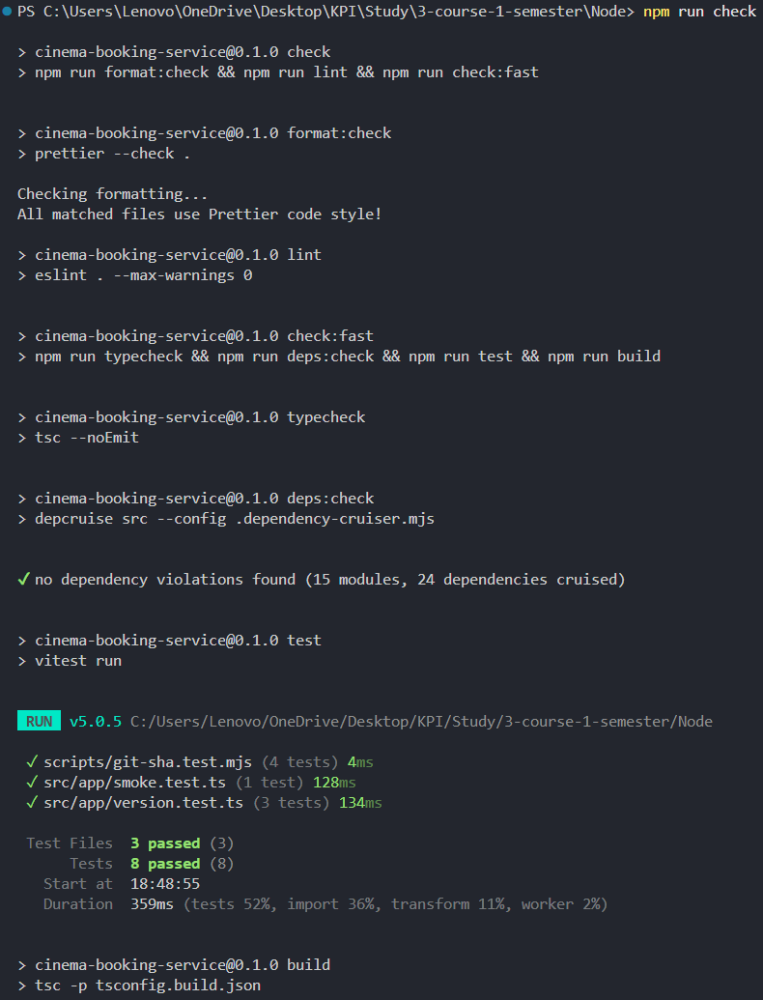
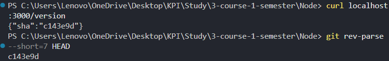
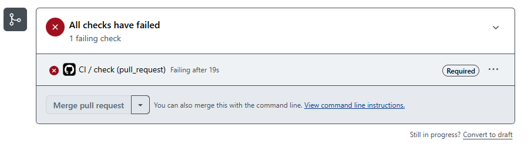

# DEFENSE — Assignment 1: Foundation and application structure

**1. What I asked the AI.** To implement the project skeleton, quality pipeline and module structure from `specs/01-foundation.md`. The spec, standards, architecture rules, ADRs and this document are mine; the AI reviewed the spec and wrote the code. Prompts and reports: `ai/`.

**2. Top-3 discrepancies I found and fixed** (spec <-> AI output):

| #   | What was wrong (against which part of the spec)                                                                                                                                                                                                                       | My trace                                                             | Fix (commits)                                             |
| --- | --------------------------------------------------------------------------------------------------------------------------------------------------------------------------------------------------------------------------------------------------------------------- | -------------------------------------------------------------------- | --------------------------------------------------------- |
| 1   | NFR-4: `import 'fastify'` in `movies/domain` passed `deps:check`, although the rules say `domain` -> only `shared` and ADR-0003 keeps the ORM in `infrastructure`. Root cause: the layer rules covered only project paths, and no AC tested an npm import in a layer. | `ai/03-review-fixes.md` §4 · `ai/05-fixes.md`                        | input: `682c110`, `d771fbe`, `0f42590` -> code: `13f8cc5` |
| 2   | FR-2 said CI sets `GIT_SHA`; the workflow didn't, and the agent decided on its own that it wasn't needed. Root cause: this part of FR-2 had no AC. Removed it from FR-2, since CI never starts the server.                                                            | `ai/02-implementation.md` · `ai/03-review-fixes.md` §1               | input: `879b48b`                                          |
| 3   | FR-2 didn't define an empty `GIT_SHA`. The agent chose a behaviour itself, and the app and the launcher then disagreed (`GIT_SHA= npm start` -> `"unknown"`). Root cause: the spec didn't cover the empty case. Defined it in FR-2 and AC-2.                          | `ai/03-review-fixes.md` §3, §5 · `ai/04-fixes.md` · `ai/05-fixes.md` | input: `879b48b`, `d771fbe` -> code: `06f9dcc`, `0839392` |

**3. Key decision:** a modular monolith where each module exposes `create<Name>Module(deps)` and declares what it needs from other modules as ports. Considered: direct service imports between modules (led to a `users <-> auth` cycle in the previous version), a layered monolith (no business boundaries), microservices (too costly for one developer). See `adr/0001-modular-monolith.md`; stack choices in `adr/0002-fastify.md` and `adr/0003-drizzle-orm.md`.

**4. Verification** (on `c143e9d`):

- `npm run check`:

  

- `npm run build && npm start`, `curl localhost:3000/version` -> `{"sha":"c143e9d"}`, equal to `git rev-parse --short=7 HEAD`:

  

- AC-3, AC-4, AC-5, AC-7 checked by breaking them (temporary commits, pushes and imports; see `ai/02-implementation.md`, `ai/05-fixes.md`).
- AC-8: `da874bc` (temporary lint error) -> CI [red run](https://github.com/Fererra/Node/actions/runs/40108138160), merge blocked; reverted in `c143e9d` -> CI [green run](https://github.com/Fererra/Node/actions/runs/40108299749).

  

**5. Structure audit** (previous version -> this spec): the top-3 wrong dependencies were a `users <-> auth` cycle, an inverted `showtime -> booking` dependency, and imports of other modules' internal files. In this design they are forbidden by `docs/architecture.md#rules` and caught by `deps:check` (AC-6, AC-7); the new code has 0 violations.
