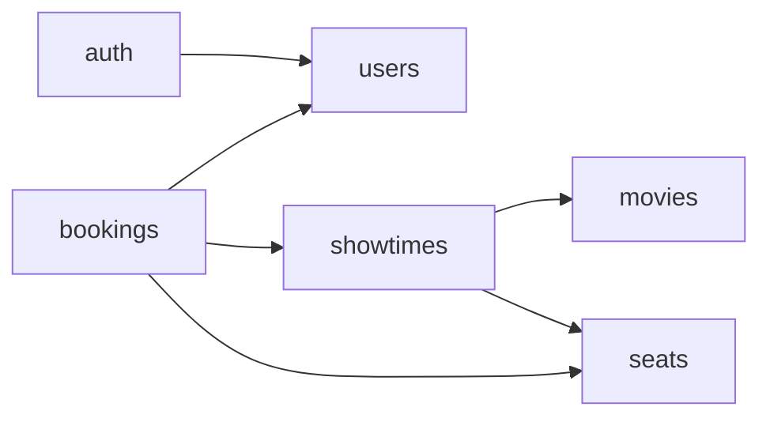
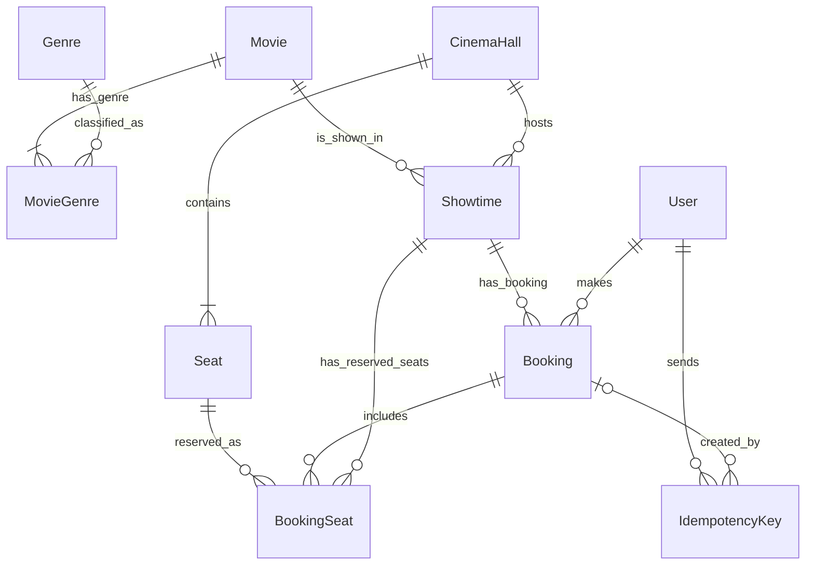

# Architecture

Source: diagrams from my earlier project ([Fererra/KPI](https://github.com/Fererra/KPI)), redrawn in Mermaid.
Updated when a lab spec changes modules, rules or data.

## Modules

`movies` owns genres; `seats` owns cinema halls and their seats.
Not shown: any module may import `shared` (`domain` only `shared/kernel/`); `src/app/` imports every module through its `index.ts`.

## Rules

Between modules:

- Only the dependencies in the graph are allowed.
- Only `application` may depend on another module, and only with `import type` from that module's `index.ts`.
- What a module needs from other modules is declared as ports in its own `application/ports/` (e.g. `bookings/application/ports/showtimes.port.ts`). These ports may `import type` from the other module's `index.ts`.
- Service instances are not imported. Each `index.ts` exports a factory `create<Name>Module(deps)` that returns `{ plugin, service }`; `deps` is typed with the module's own ports. `src/app/` creates modules in dependency order and passes the services they need as `deps`.

Module entry point:

- `index.ts` is the module's assembly point. It may import all layers of its own module, but nothing from other modules.
- It exports the factory, the service interface, DTO types and error types.

App and shared:

- `src/app/` is the composition root and holds `/health` and `/version`. It imports modules only through `index.ts` and may import `shared`.
- Modules don't import `app`.
- Any module or layer except `domain` may import `shared`; `shared` imports no module and not `app`.
- `src/shared/kernel/` holds plain types and helpers: no npm packages and no imports from the rest of `shared`. `domain` may import only `shared/kernel/`, so it can't reach a package through `shared`.
- `src/shared/context.ts` holds the request context (AsyncLocalStorage: `requestId`, `user`, current transaction) and `getContext()`; `src/shared/unit-of-work.ts` holds the `UnitOfWork` port. Any layer except `domain` may use them (ADR-0004).
- `src/shared/db/` holds the DB pool, the `UnitOfWork` implementation and the "transaction or pool" executor. Only module `infrastructure` layers and `src/app/` may import it.

Layers inside a module:

- `http` → `application`
- `infrastructure` → `application`, `domain`
- `application` → `domain`; no framework or ORM packages (`fastify`, `drizzle-orm`)
- `domain` → only `shared/kernel/`; no npm packages
- Ports live in `application/ports/`. `http` maps application errors to HTTP codes.
- Layer folders appear when code appears.
- "Packages" means npm packages, including type-only imports; Node built-ins (`node:*`) are allowed. Framework packages are `fastify` and `@fastify/*`.

## Data

Conceptual ER: foreign keys are implied by relations and not drawn.

### Physical schema (from Lab 2)

All ids are `uuid`, generated by the app. Times are `timestamptz`.

| Table             | Columns                                                                            | Keys and constraints                                                                                                         |
| ----------------- | ---------------------------------------------------------------------------------- | ---------------------------------------------------------------------------------------------------------------------------- |
| `genre`           | `id`, `name`                                                                       | PK `id`; unique `name`                                                                                                       |
| `movie`           | `id`, `title`, `duration_min`, `age_limit`, `release_year`, `description`          | PK `id`; check `duration_min > 0`                                                                                            |
| `movie_genre`     | `movie_id`, `genre_id`                                                             | PK `(movie_id, genre_id)`; FK to `movie`, `genre`                                                                            |
| `cinema_hall`     | `id`, `hall_number`                                                                | PK `id`; unique `hall_number`                                                                                                |
| `seat`            | `id`, `hall_id`, `row`, `number`, `seat_type` (`STANDARD` \| `VIP`)                | PK `id`; FK `hall_id`; unique `(hall_id, row, number)`                                                                       |
| `showtime`        | `id`, `movie_id`, `hall_id`, `starts_at`                                           | PK `id`; FK `movie_id`, `hall_id`; index `(movie_id, starts_at)`                                                             |
| `users`           | `id`, `name`, `email`                                                              | PK `id`; unique `email`                                                                                                      |
| `booking`         | `id`, `user_id`, `showtime_id`, `status` (`RESERVED` \| `CANCELLED`), `created_at` | PK `id`; FK `user_id`, `showtime_id`; unique `(id, showtime_id)`; index `user_id`                                            |
| `booking_seat`    | `showtime_id`, `seat_id`, `booking_id`                                             | PK `(showtime_id, seat_id)`; FK `seat_id`; FK `(booking_id, showtime_id)` -> `booking (id, showtime_id)`; index `booking_id` |
| `idempotency_key` | `user_id`, `key`, `request_hash`, `booking_id`, `created_at`                       | PK `(user_id, key)`; FK `user_id`, `booking_id`                                                                              |

`users` is plural because `user` is a reserved word in PostgreSQL.

Rules the schema enforces:

- A seat can't be booked twice for one showtime: PK `(showtime_id, seat_id)` on `booking_seat`.
- All seats of a booking have the booking's showtime: composite FK `(booking_id, showtime_id)`.

Rules the application enforces (in `bookings/application`, inside the same transaction):

- A seat belongs to the showtime's hall.
- A booking can't be made or cancelled after the showtime has started.

Changes from the previous version's ER: `show_date` + `show_time` -> one `starts_at`; `capacity` dropped (it is the number of seats); `total_price` and seat prices dropped (tariffs and payments are out of scope); `Customer` -> `User`; new `idempotency_key`.
