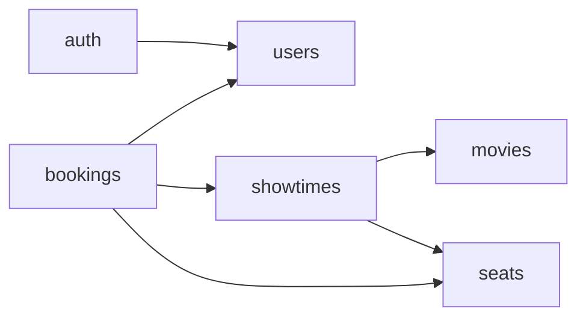
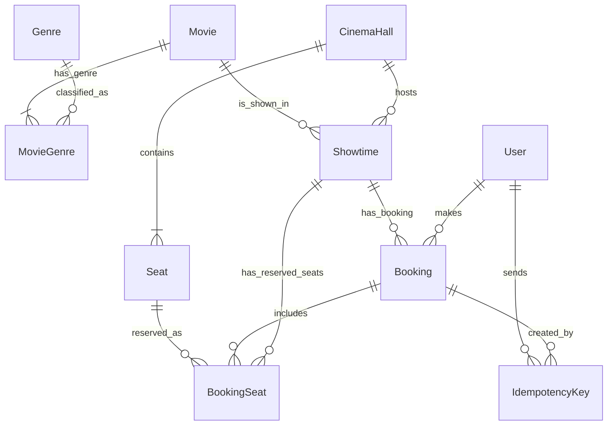

# Architecture

Source: diagrams from my earlier project ([Fererra/KPI](https://github.com/Fererra/KPI)), redrawn in Mermaid.
Updated when a lab spec changes modules, rules or data. API contract: [`api.md`](api.md).

## Modules

`movies` owns genres; `seats` owns cinema halls and their seats; `bookings` owns bookings, booked seats and idempotency keys.
Not shown: any module may import `shared` (`domain` only `shared/kernel/`); `src/app/` imports every module through its `index.ts`.

A route lives in the module that owns the data it combines: `GET /showtimes/:id/seats` is in `bookings`, because `taken` comes from `booking_seat`.

Cross-module ports used in Lab 2 (batch where a list is involved):

| Consumer    | Port method                | Returns                                                                           |
| ----------- | -------------------------- | --------------------------------------------------------------------------------- |
| `showtimes` | `seats.getHallsByIds(ids)` | `{ id, number }`                                                                  |
| `showtimes` | `movies.getByIds(ids)`     | `{ id, title }`                                                                   |
| `bookings`  | `showtimes.getByIds(ids)`  | `{ id, startsAt, hallId, hallNumber, movieTitle }` (titles batched from `movies`) |
| `bookings`  | `seats.getByHall(hallId)`  | `{ id, row, number, type }` of the hall                                           |
| `bookings`  | `seats.getByIds(ids)`      | `{ id, hallId, row, number }`                                                     |
| `bookings`  | `users.getById(id)`        | `{ id, name }` (user loading for FR-4…FR-6)                                       |

## Rules

Between modules:

- Only the dependencies in the graph are allowed.
- Only `application` may depend on another module, and only with `import type` from that module's `index.ts`.
- What a module needs from other modules is declared as ports in its own `application/ports/` (e.g. `bookings/application/ports/showtimes.port.ts`). These ports may `import type` from the other module's `index.ts`.
- Cross-module ports offer batch methods (e.g. `getByIds(ids)`) where a list is involved, so a list endpoint doesn't call another module once per item.
- A module's `infrastructure` queries only its own tables; data of other modules comes only through ports.
- Service instances are not imported. Each `index.ts` exports a factory `create<Name>Module(deps)` that returns `{ plugin, service }`; `deps` is typed with the module's own ports. `src/app/` creates modules in dependency order and passes the services they need as `deps`.

Module entry point:

- `index.ts` is the module's assembly point. It may import all layers of its own module, but nothing from other modules. It may `import type` from `shared/db/` to type the factory's `storage` option; value imports from `shared/db/` stay forbidden.
- It exports the factory, the service interface, DTO types and error types.

App and shared:

- `src/app/` is the composition root and holds `/health` and `/version`. It exposes `buildApp({ storage: 'memory' | 'postgres' })`, imports modules only through `index.ts` and may import `shared`. `npm start` reads `STORAGE` (default `postgres`).
- `src/app/seed.ts` exports `buildSeed(now)`: plain seed data with fixed UUIDs (2 users, halls, seats, movies, genres, showtimes relative to `now`). It feeds in-memory storage, tests and the `db:seed` CLI in `src/app/cli/`.
- Modules don't import `app`.
- Any module or layer except `domain` may import `shared`; `shared` imports no module and not `app`.
- `src/shared/kernel/` holds plain types and helpers: no npm packages and no imports from the rest of `shared`. `domain` may import only `shared/kernel/`, so it can't reach a package through `shared`.
- Shared ports are the one exception to "ports live in `application/ports/`": `src/shared/unit-of-work.ts` (`UnitOfWork`) and `src/shared/clock.ts` (`Clock`), because every module uses them.
- `src/shared/context.ts` holds the request context (AsyncLocalStorage: `requestId`, `user`, current transaction) and `getContext()`. `src/shared/retry.ts` holds `withRetry`, a pure function with no packages that logs each attempt. Any layer except `domain` may use them (ADR-0004).
- `src/shared/errors.ts` holds `AppError` with the error codes of `docs/api.md`; `src/shared/logger.ts` holds the `Logger` interface and the log fields taken from the context. Like the other shared files above, they import no npm packages, only each other and `shared/kernel/`.
- The global error handler in `src/app/` maps error codes to HTTP statuses in one table; modules throw `AppError` and don't map statuses themselves.
- `src/shared/db/` holds the DB pool, the `UnitOfWork` implementation and the "transaction or pool" executor; `src/shared/db/schema/` holds the Drizzle schema, one file per owning module (`movies.ts`, `seats.ts`, `showtimes.ts`, `users.ts`, `bookings.ts`). Schema files may import each other for foreign keys. Only module `infrastructure` layers and `src/app/` may import `shared/db/`, and a module's `infrastructure` may import only its own schema file. Migrations live in `drizzle/`.
- Test-only code lives in `test/`, outside `src/`, and isn't checked by dependency-cruiser. `test/support/fixtures.ts` may write to any table to build data for size tests.

Layers inside a module:

- `http` → `application`
- `infrastructure` → `application`, `domain`
- `application` → `domain`; no framework or ORM packages (`fastify`, `drizzle-orm`)
- `domain` → only `shared/kernel/`; no npm packages
- Ports live in `application/ports/` (except the shared ports above). Status codes come from the global error handler, not from `http`.
- Layer folders appear when code appears.
- "Packages" means npm packages, including type-only imports; Node built-ins (`node:*`) are allowed. Framework packages are `fastify` and `@fastify/*`.

## Data

Conceptual ER: foreign keys are implied by relations and not drawn.

### Physical schema (from Lab 2)

All ids are `uuid`, generated by the app. Times are `timestamptz`. Cross-module foreign keys exist only at the database level; code reaches other modules' data through ports.

| Table             | Owner       | Columns                                                                            | Keys and constraints                                                                                                                         |
| ----------------- | ----------- | ---------------------------------------------------------------------------------- | -------------------------------------------------------------------------------------------------------------------------------------------- |
| `genre`           | `movies`    | `id`, `name`                                                                       | PK `id`; unique `name`                                                                                                                       |
| `movie`           | `movies`    | `id`, `title`, `duration_min`, `age_limit`, `release_year`, `description`          | PK `id`; check `duration_min > 0`                                                                                                            |
| `movie_genre`     | `movies`    | `movie_id`, `genre_id`                                                             | PK `(movie_id, genre_id)`; FK to `movie`, `genre`                                                                                            |
| `cinema_hall`     | `seats`     | `id`, `hall_number`                                                                | PK `id`; unique `hall_number`                                                                                                                |
| `seat`            | `seats`     | `id`, `hall_id`, `row`, `number`, `seat_type` (`STANDARD` \| `VIP`)                | PK `id`; FK `hall_id`; unique `(hall_id, row, number)`                                                                                       |
| `showtime`        | `showtimes` | `id`, `movie_id`, `hall_id`, `starts_at`                                           | PK `id`; FK `movie_id`, `hall_id`; index `(movie_id, starts_at)`                                                                             |
| `users`           | `users`     | `id`, `name`, `email`                                                              | PK `id`; unique `email`                                                                                                                      |
| `booking`         | `bookings`  | `id`, `user_id`, `showtime_id`, `status` (`RESERVED` \| `CANCELLED`), `created_at` | PK `id`; FK `user_id`, `showtime_id`; unique `(id, showtime_id)`; index `(user_id, created_at)`                                              |
| `booking_seat`    | `bookings`  | `showtime_id`, `seat_id`, `booking_id`                                             | PK `(showtime_id, seat_id)`; FK `seat_id`; FK `(booking_id, showtime_id)` -> `booking (id, showtime_id)`; index `booking_id`                 |
| `idempotency_key` | `bookings`  | `user_id`, `key` (1–255), `request_hash`, `booking_id` (not null), `created_at`    | PK `(user_id, key)`; FK `user_id`; FK `booking_id` deferrable, initially deferred (a hand-written SQL migration if Drizzle can't express it) |

`users` is plural because `user` is a reserved word in PostgreSQL. `created_at` values come from `Clock`, not from a database default.

Rules the schema enforces:

- A seat can't be booked twice for one showtime: PK `(showtime_id, seat_id)` on `booking_seat`.
- All seats of a booking have the booking's showtime: composite FK `(booking_id, showtime_id)`.
- An idempotency key always points to a created booking: `booking_id` is not null, and its FK is checked at commit, so the key can be inserted before the booking.

Rules the application enforces (in `bookings/application`, inside `uow.run`):

- A seat belongs to the showtime's hall.
- A booking can't be made or cancelled after the showtime has started (`starts_at <= now`, `now` from `Clock`).
- Insert order with PostgreSQL: claim `idempotency_key` -> `booking` -> `booking_seat` sorted by `seat_id`. In memory: look up the key -> checks -> the final write re-checks the key and the seats and writes everything in one synchronous step (see `api.md#idempotency`).

Changes from the previous version's ER: `show_date` + `show_time` -> one `starts_at`; `capacity` dropped (it is the number of seats); `total_price` and seat prices dropped (tariffs and payments are out of scope); `Customer` -> `User`; new `idempotency_key`.
