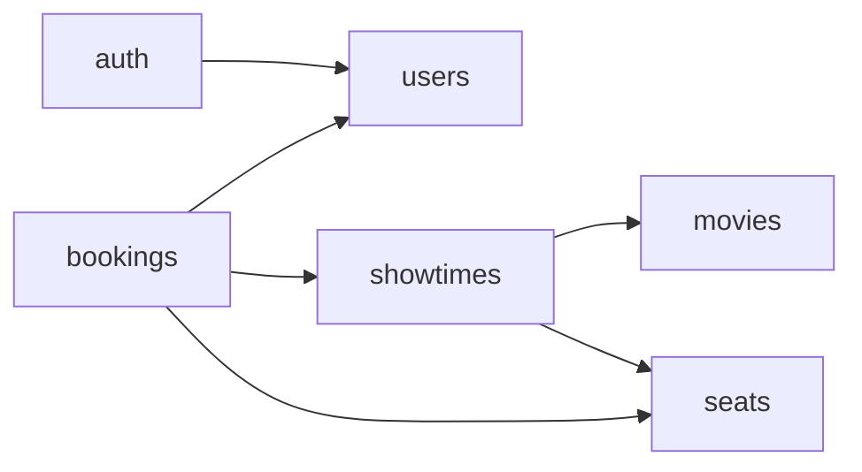
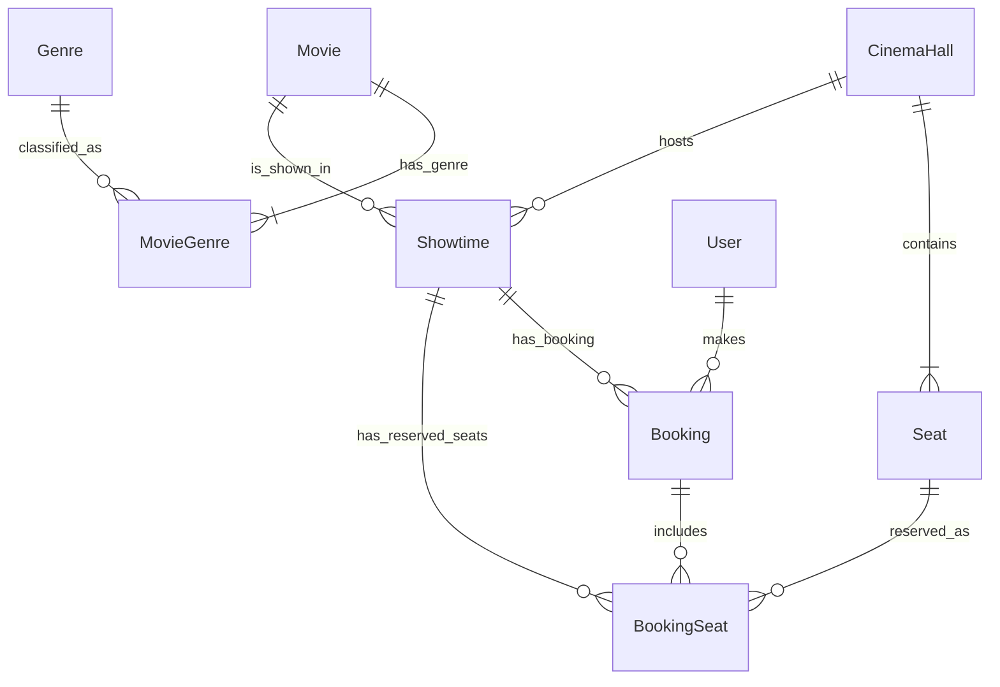

# Architecture

Source: diagrams from my earlier project ([Fererra/KPI](https://github.com/Fererra/KPI)), redrawn in Mermaid.
Updated when a lab spec changes modules, rules or data.

## Modules

`movies` owns genres; `seats` owns cinema halls and their seats.
Not shown: any module may import `shared`; `src/app/` imports every module through its `index.ts`.

## Rules

Between modules:
- Only the dependencies in the graph are allowed.
- Only `application` may depend on another module, and only with `import type` from that module's `index.ts`.
- What a module needs from other modules is declared as ports in its own `application/ports/` (e.g. `bookings/application/ports/showtimes.port.ts`). These ports may `import type` from the other module's `index.ts`.
- Service instances are not imported. Each `index.ts` exports a factory `create<Name>Module(deps)` that returns `{ plugin, service }`; `deps` is typed with the module's own ports. `src/app/` creates modules in dependency order and passes the services they need as `deps`.

Module entry point:
- `index.ts` is the module's assembly point. It may import all layers of its own module, but nothing from other modules.
- It exports the factory, the service interface, DTO types and error types.

App and shared:
- `src/app/` is the composition root and holds `/health` and `/version`. It imports modules only through `index.ts` and may import `shared`.
- Modules don't import `app`.
- Any module or layer may import `shared`; `shared` imports no module and not `app`.

Layers inside a module:
- `http` → `application`
- `infrastructure` → `application`, `domain`
- `application` → `domain`
- `domain` → only `shared`
- Ports live in `application/ports/`. `http` maps application errors to HTTP codes.
- Layer folders appear when code appears.

## Data

Conceptual ER: foreign keys are implied by relations and not drawn.

