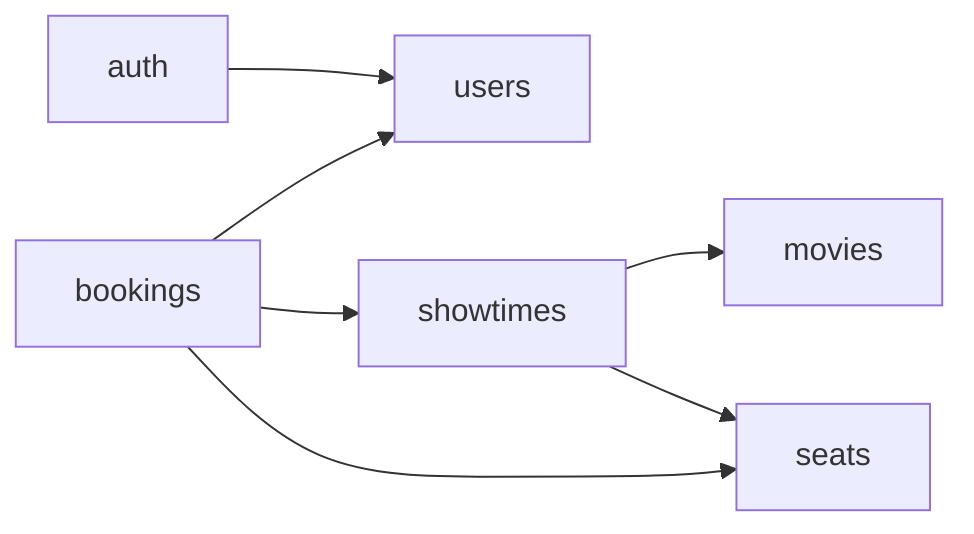

# Architecture

Source: diagrams from my earlier project ([Fererra/KPI](https://github.com/Fererra/KPI)), redrawn in Mermaid.
Updated when a lab spec changes modules or data.

## Modules

`movies` owns genres; `seats` owns cinema halls and their seats.

## Data

Conceptual ER: foreign keys are implied by relations and not drawn.

